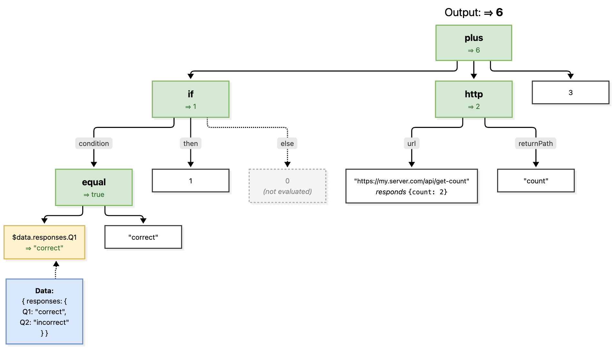

# fig-tree-evaluator

<picture>
  <source media="(prefers-color-scheme: dark)" srcset="images/FigTreeEvaluator_logo_600_dark.png">
  
</picture>

**Dynamic logic for your config, written as plain JSON.**

FigTree evaluates expressions written as JSON. It lets you put real logic in places that can only hold data, like a config file, a database row or a form definition, without ever running code that came from outside your app.

<details>
<summary><strong>Upgrading from v2?</strong></summary>

> v3 is a significant redesign, and there's a converter for your existing expressions. See [Migrating from v2](https://DOCS_URL/migrating/). The v2 docs are on the [`v2.x` branch](https://github.com/CarlosNZ/fig-tree-evaluator/tree/v2.x).

</details>

## A quick example

**Make any value dynamic.** Say your app builds forms from JSON definitions, and one of the fields looks like this:

```json
{
  "label": "Driver licence number",
  "type": "text",
  "visible": true
}
```

That's fine until someone asks for the field to show only for licensed drivers aged 16 or over, and for some help text that names the user's country. Normally that's the point where the logic moves out of the config and into your code, as yet another special case. With FigTree, it stays where it belongs:

```json
{
  "label": "Driver licence number",
  "type": "text",
  "visible": { "$and": [{ "$>=": ["$data.age", 16] }, "$data.hasLicence"] },
  "helpText": { "$buildString": "Required for drivers in {{$data.country}}" }
}
```

Give that to FigTree along with the current user's data:

```js
const user = { age: 34, hasLicence: true, country: 'New Zealand' } // from your app's state

const field = await fig.evaluate(fieldDefinition, { data: user })
```

and you get plain config back, ready to use:

```json
{
  "label": "Driver licence number",
  "type": "text",
  "visible": true,
  "helpText": "Required for drivers in New Zealand"
}
```

There are only two rules to learn to read that:

- a **key** starting with `$` runs an operator (`$and`, `$>=`, `$buildString`)
  - that's shorthand: `{ "$and": [...] }` can also be written in full as `{ "operator": "and", "values": [...] }`, which is easier for tools and editors to work with
- a **string** starting with `$` reads a value (`"$data.age"`)

Everything else is left exactly as it is.

And it's still just JSON. You can store it in a database, send it over the network, or let an admin edit it in a UI, and nothing in it can execute code. An expression can only do what the operators you've registered allow, so it can't even make an HTTP request or query a database unless you've given FigTree a client to do it with.

### [Try it in the Playground](https://DOCS_URL/playground/)

## Features

- 🔒 **Sandboxed**: nothing in an expression can execute code; it can only use the operators you register
- 🧮 **Around 40 built-in operators**: logic, comparison, maths, strings, arrays and objects
- 🌐 **HTTP, GraphQL and SQL lookups**: with a client you pass in, so nothing you don't use ends up in your bundle
- 🛟 **Fallbacks** on any node, for bad responses and bad data
- ✅ **Checked before it runs**: unknown operators (with "did you mean...") and malformed parameters are caught up front
- 🧩 **Fragments**: named, reusable expressions that you call like operators and compose into larger ones
- 🛠️ **[Custom operators](https://DOCS_URL/custom-operators/)**: fully typed, written with `defineOperator`
- 🎨 **[Visual editor](https://github.com/CarlosNZ/fig-tree-editor-react)**: drop an expression editor into your own app

It's a good fit wherever rules change more often than code:

- Eligibility or pricing rules that non-developers can change without a deploy
- Feature-flag targeting: who sees what, based on the user's data
- Workflow conditions: when a step runs, and who it goes to
- Email and message templates that go beyond filling in placeholders, with whole sections that appear or change based on the recipient's data

It runs throughout [Conforma](https://github.com/openmsupply/conforma-web-app), a configurable system for managing application forms: conditional visibility, validation rules that go well beyond what a validation library offers, event-driven back-end actions, and data view configuration. And here's a [demo](https://github.com/CarlosNZ/jsonforms-with-figtree-demo) extending [JSON Forms](https://jsonforms.io) with conditional logic and dynamic lookups.

## The basics

Every expression is a tree. Each branching point is a **node**: an **operator** plus its parameters. A parameter can be a plain value or another node, nested as deep as you need. A node's result becomes a parameter value for the node above it, and the result at the top is what you get back.

The simplest node:

<!-- prettier-ignore -->
```js
{ $plus: [1, 2, 3] }
// → 6
```

That's the **shorthand** form you saw above. Every node also has the **canonical** form, which spells everything out, and the two are interchangeable:

```js
{ operator: 'plus', values: [1, 2, 3] }
// → 6
```

Shorthand is nicer to write by hand; the canonical form is easier for tools and editors to work with. Use whichever suits, and mix them freely.

Here's the same result from a deeper tree — the `1` and `2` have each been replaced by a node of their own. One checks an answer in the user's data, the other asks an API for a number:

```js
{
  $plus: [
    { $if: [{ '$=': ['$data.responses.Q1', 'correct'] }, 1, 0] },
    { $http: { url: 'https://my.server.com/api/get-count', returnPath: 'count' } },
    3,
  ],
}
// → 6
```

Represented as a tree, with each node's result under its name:



<details>
<summary>The same expression in canonical form</summary>

```js
{
  operator: 'plus',
  values: [
    {
      operator: 'if',
      condition: { operator: 'equal', values: ['$data.responses.Q1', 'correct'] },
      then: 1,
      else: 0,
    },
    { operator: 'http', url: 'https://my.server.com/api/get-count', returnPath: 'count' },
    3,
  ],
}
```

</details>

## When things go wrong

Expressions often come from people, and they often run against data you didn't write. So FigTree's rule is to be _strict where it can be, and forgiving where it has to be_.

Mistakes in the expression itself are caught before anything runs:

```js
fig.validate({ $plsu: [1, 2] })
// → '$plsu' is not a registered operator or fragment — did you mean '$plus'?
```

There's no silent type coercion either: `{ $plus: [1, 'two'] }` is an error, not `'1two'`.

And where something can only go wrong at runtime, like a bad API response or a division by zero, any node can carry a `fallback`, which stands in when that node fails:

```js
{ $divide: ['$data.total', '$data.count'], fallback: 'No orders yet' }
// with count: 0 → 'No orders yet'
```

## Install

```sh
npm install fig-tree-evaluator
```

FigTree is ESM-only, written in TypeScript with its types included, and needs Node 22.12 or later (or any modern browser).

## Usage

```ts
import { FigTree } from 'fig-tree-evaluator'

const fig = new FigTree()

const result = await fig.evaluate(expression, { data: { user, responses } })
```

HTTP and SQL operators need a client, which you choose and pass in. This keeps them out of your bundle if you don't use them, and out of your expressions if you don't want them there:

```ts
import { FigTree, coreOperators, httpOperators, FetchClient } from 'fig-tree-evaluator'

const fig = new FigTree({
  operators: [coreOperators, httpOperators(new FetchClient())],
})
```

## Documentation

The full documentation is at **[DOCS_URL](https://DOCS_URL/)**:

- **[Concepts](https://DOCS_URL/concepts/)**: how expressions are built and evaluated, data references, shorthand and canonical forms
- **[Guides](https://DOCS_URL/guides/)**: fallbacks and errors, fragments, HTTP and SQL, caching, tracing
- **[API reference](https://DOCS_URL/api/)**: the `FigTree` class, its options and methods
- **[Operator reference](https://DOCS_URL/operators/)**: every built-in operator and its parameters
- **[Custom operators](https://DOCS_URL/custom-operators/)**: adding your own with `defineOperator`
- **[Tooling](https://DOCS_URL/tooling/)**: building editors and other tools around FigTree, with form conversion, static analysis and operator metadata for UIs
- **[Migrating from v2](https://DOCS_URL/migrating/)**: what's changed and how to upgrade, the converter that rewrites your expressions, and the few cases it leaves to you
- **[Playground](https://DOCS_URL/playground/)**: try expressions in your browser

For a visual editor in your own app, see [fig-tree-editor-react](https://github.com/CarlosNZ/fig-tree-editor-react).

## Help, feedback, suggestions

Please [open an issue](https://github.com/CarlosNZ/fig-tree-evaluator/issues).

## Credit

Icon: Tree by ka reemov from [Noun Project](https://thenounproject.com/icon/tree-2665898/)
