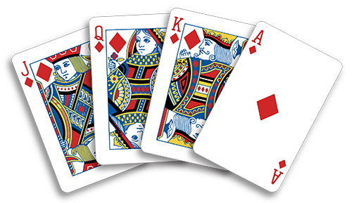

# Card game recommender

Which card game should we play? It depends on how many players there are, the age of the youngest, and how hard a game they'd like.

Rules like these could be written as a tree of `if`s, but every new game would mean a new branch. Here, the games are in the data instead, each with the players and ages it suits, and the expression stays the same however many games there are:

- **`filter`** keeps every game that suits the players. With `as: 'game'`, the game being checked is `$game`.
- **`find`** picks the first of those at the preferred difficulty. If there's none, the first suitable game is recommended.

Things to try:

- Change `players` to 1, or `youngestAge` to 3.
- Change `difficulty` to `'hard'`, and `youngestAge` to 16.
- Add a game of your own to `games`.
