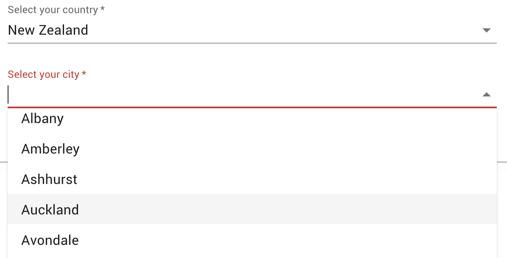

# List of cities based on country selection

A classic case for a form input is to choose your country from a drop-down, then subsequently select from a list of cities based on your selected country. With a FigTree expression, we can populate this list dynamically with a call to an [online countries database](https://countriesnow.space/).

This expression returns the city list based on the `country` value in `userResponses`. You can see this applied to a real form with [this example](https://carlosnz.github.io/jsonforms-with-figtree-demo/) which uses FigTree to extend the dynamic functionality of [JSON Forms](https://jsonforms.io/).

Note the `fallback` property used here — an array with a _"Loading..."_ indicator. This ensures that the Cities dropdown can render with a valid `options` list even if the online lookup returns an error due to an invalid or incomplete "country" value.
