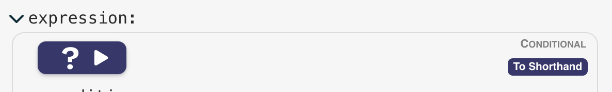

# Conditional logic


The result of this expression determines whether the filmgoer is allowed entry to the film, based on their age and whether or not they have a parent in attendance.

The rule is: the filmgoer must meet the minimum age restriction, unless they have a parent with them, in which case they must be over 13 years old.

Note that the data is read with _references_, such as `"$data.patron.age"`. A reference is just a convenience to make complex expressions less verbose. So instead of:

```
{ "$get": "patron.age" }
```

we can just write:

```
"$data.patron.age"
```

Note that you can toggle any node to and from Shorthand form with the hover button on the right of each node header:


