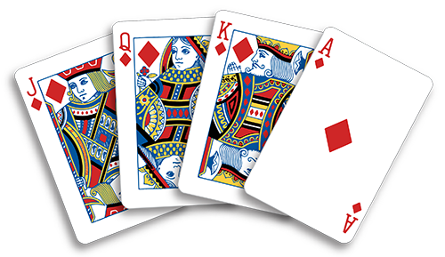

# Decision Tree (for card games)

This expression demonstrates a fairly convoluted [Decision tree](https://en.wikipedia.org/wiki/Decision_tree), making heavy use of the [Match](/reference/operators/#op-match) operator to handle conditional logic with multiple branches.

A diagram of this particular tree can be found [here](https://user-images.githubusercontent.com/5456533/208660132-39f42ecf-894f-4e7a-891d-ce3a2d184d02.png).

_Hot tip: Click the "Expand" icon at the top of the expression object while holding "Option"/"Alt" to quickly expand the entire expression tree at once._

This expression also declares `vars`, values defined once and read with references such as `"$vars.difficultyOlder"`, which reduces the amount of duplication required in this structure.
