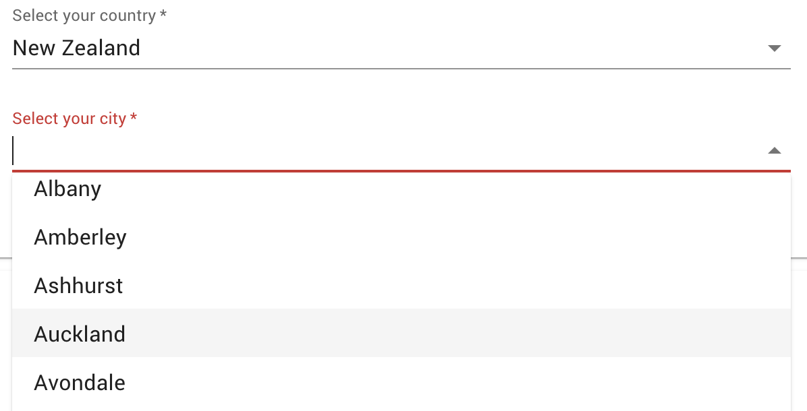

# A form, configured

FigTree is for logic in places that can only hold data, such as a form definition. This expression is a sign-up form, written as a form library might take it, and the data on the left is what's been filled in so far. Most of each field's settings are fixed values, but any of them can be a rule:

- **`options`**, on the city: the cities in the chosen country, looked up from an [online countries database](https://countriesnow.space/). Its `fallback` gives an empty list when the lookup fails, so the form always has a list to show.
- **`required`**, on the postcode: required unless the country doesn't use postcodes.
- **`visible`**, on the licence number: shown only to someone 16 or over.

Press **Evaluate** at the top of the tree, and the result is the form with every rule worked out, ready for the form library.

Things to try:

- Change `country` to `'New Zealand'`. The city list is much longer, and the postcode becomes required.
- Change `age` to 15, and the licence number is hidden.
- Change `country` to one the lookup doesn't know, such as `'Narnia'`, and the city list is empty.

To see this in a real form, [this example](https://carlosnz.github.io/jsonforms-with-figtree-demo/) uses FigTree to add dynamic behaviour to [JSON Forms](https://jsonforms.io/):

